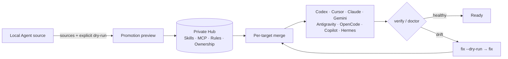

<p align="right">
  English · <a href="README.zh-CN.md">简体中文</a>
</p>

<picture>
  <source media="(prefers-color-scheme: dark)" srcset="assets/readme/agent-sync-hero-dark.svg">
  <source media="(prefers-color-scheme: light)" srcset="assets/readme/agent-sync-hero-light.svg">
  
</picture>

<p align="center">
  <strong>One private Hub for Skills, MCP servers, rules, and capability ownership across your AI agents.</strong>
</p>

<p align="center">
  <a href="LICENSE"></a>
  
  
  
</p>

<p align="center">
  <a href="#why-agent-sync">Why</a> ·
  <a href="#60-second-quick-start">Quick start</a> ·
  <a href="#supported-tools">Supported tools</a> ·
  <a href="#safety-by-design">Safety</a> ·
  <a href="#command-reference">Commands</a>
</p>

## Why agent-sync

Using several AI coding agents creates a configuration problem before it creates
an intelligence problem:

- every product stores Skills, MCP servers, and instructions in different places;
- a product plugin and a shared Hub can expose the same capability twice;
- shared definitions, machine-local paths, and credentials need different owners.

`agent-sync` turns those scattered configurations into one auditable system. The
public repository contains only the synchronizer. Your desired shared state lives
in a separate private Hub, while product-owned plugins and local credentials stay
with their products.

## What makes it different

| Capability | What agent-sync does |
|---|---|
| Skills | Symlinks an explicit Hub allowlist to supported agents |
| MCP | Merges shared servers without replacing tool-only servers or local secrets |
| Rules | Injects managed blocks while preserving unrelated instructions |
| Ownership | Selects one effective provider per capability and target |
| Promotion | Ranks existing configs, previews a source, and promotes only after an explicit command |
| Health | Explains drift through `status`, `verify`, `doctor`, and `fix --dry-run` |

This is a control plane, not a second plugin manager. Native extensions remain
owned by Cursor, Codex, Claude, Gemini, VS Code, or their original product.

## 60-second quick start

```bash
git clone https://github.com/LittlePeter52012/agent-sync.git ~/.local/share/agent-sync
ln -sf ~/.local/share/agent-sync/bin/agent-sync ~/.local/bin/agent-sync

agent-sync init
```

The public `agent-sync` repository is the synchronizer. `init` creates a
separate, empty private Agent Hub at `~/.config/agent-hub`; it does not activate
the demonstration Skills, MCP servers, rules, or hooks from this repository.

**If one Agent is already configured the way you want:**

```bash
agent-sync sources
# Replace TOOL with the recommended source shown above.
agent-sync sync --from TOOL --dry-run
agent-sync sync --from TOOL
agent-sync verify --strict --scope managed
```

**If you are starting from scratch:**

```bash
# Edit manifest.yaml, skills/, mcp/shared-servers.json, and optional rules/.
agent-sync all
agent-sync verify --strict --scope managed
```

`sources` is read-only. `sync --from` previews the MCP changes before promotion;
it never chooses a source from modification time alone. `all` distributes the
current Hub state and runs managed verification, without discovering or
approving package updates. `agent-sync sync` remains the direct Hub-to-targets
command; use `agent-sync doctor --runtime` for a broader local health report.

## Supported tools

| Surface | Skills | Shared MCP | Managed rules | Scope notes |
|---|:---:|:---:|:---:|---|
| Codex / ChatGPT | ✓ | ✓ | ✓ | Preserves product plugins and tool-only MCP |
| Claude Code | ✓ | ✓ | ✓ | Uses the official user-scoped MCP CLI |
| Cursor | ✓ | ✓ | — | Product plugins can own reviewed capabilities |
| Gemini CLI | ✓ | ✓ | ✓ | Uses the official `~/.agents/skills` alias |
| Gemini global | ✓ | ✓ | ✓ | Separate global configuration surface |
| Antigravity App | ✓ | ✓ | shared | Independent App surface |
| Antigravity CLI (`agy`) | ✓ | ✓ | shared | Preferred Antigravity automation interface |
| Antigravity IDE | ✓ | ✓ | shared | Independent IDE configuration and extension state |
| OpenCode | ✓ | ✓ | — | OpenCode-only orchestration stays product-owned |
| VS Code / Copilot | ✓ | ✓ | ✓ | Includes existing VS Code Profiles |
| Hermes | ✓ | — | — | Shared Skills through native `skills.external_dirs` in the default config and detected profiles |
| Multica | allowlist | — | allowlist | Optional, explicit control-plane adapter only |

“Shared” means the Gemini/Antigravity family consumes the single managed global
rule surface rather than receiving duplicate rule files.

## How it works



The Hub is the desired shared state. Target adapters translate that state to
each product's format, preserve target-owned values, and verify the result.

## Safety by design

- **Public tool, private state.** This repository contains generic code and
  examples; personal Skills, MCP definitions, rules, and retired names belong
  in the private Hub.
- **Credentials stay local.** Hub definitions use `${ENV_VAR}` placeholders.
  Existing target credentials can be preserved without being printed.
- **One owner per capability.** A reviewed product plugin can suppress the
  matching Hub bundle for that target, preventing duplicate tools.
- **One mutation interface.** Do not update the same object through a CLI and an
  MCP at the same time.
- **Local execution is not an offline guarantee.** A locally launched CLI or MCP
  may still send data to its configured cloud API; execution location and data
  destination are reported separately.
- **Fail closed.** Ambiguous owners, malformed policy, unsafe public/private
  boundaries, and unresolved placeholders stop the operation.

## Common workflows

```bash
agent-sync status                              # concise coverage overview
agent-sync ownership                          # explain capability providers
agent-sync verify                             # structural verification
agent-sync verify --strict --scope managed    # Hub-managed runtime gate
agent-sync fix --dry-run                       # preview deterministic repairs
agent-sync audit                              # tokens, PII, and repo visibility
```

Adopt an existing MCP configuration explicitly:

```bash
agent-sync sources
agent-sync sync --from TOOL --dry-run
agent-sync sync --from TOOL
```

## Command reference

| Command | Purpose |
|---|---|
| `agent-sync init` | Create an empty private Hub starter; examples stay opt-in |
| `agent-sync sources [--json]` | Rank local MCP source candidates without writing |
| `agent-sync sync [--from TOOL] [--dry-run\|--yes]` | Distribute Hub state or explicitly promote one MCP source first |
| `agent-sync skills [--force]` | Link allowlisted Skills to supported tools |
| `agent-sync mcp` | Merge shared MCP while keeping target-owned servers and secrets |
| `agent-sync rules` | Reconcile managed instruction blocks |
| `agent-sync ownership [CAPABILITY] [--target TARGET] [--json]` | Explain the effective provider |
| `agent-sync trace mcp NAME` | Show secret-free MCP ownership and locations |
| `agent-sync list` / `status` | Show coverage and current state |
| `agent-sync verify [--strict] [--scope all\|managed]` | Verify structure and optional runtime health |
| `agent-sync doctor [--runtime] [--strict] [--scope all\|managed]` | Diagnose configuration, ownership, and runtime health |
| `agent-sync fix [--dry-run]` | Preview or apply bounded deterministic repairs |
| `agent-sync all [--force]` | Full Skills + MCP + Rules sync and managed runtime gate |
| `agent-sync test` | Run Python, syntax, privacy, and Bash evaluation suites |
| `agent-sync update [--check] [--hub] [--sync]` | Update the tool and optionally the Hub and targets |
| `agent-sync pull` / `push [-m MSG]` | Pull or privacy-check and push the private Hub |

<details>
<summary><strong>Gemini and Antigravity surfaces</strong></summary>

Gemini CLI, Gemini global, Antigravity App, Antigravity CLI, and Antigravity IDE
are separate configuration consumers. The standalone Antigravity CLI is `agy`;
an executable named `antigravity` may only launch the desktop app. Skills remain
Hub-backed links, MCP merges preserve local servers and credentials, and shared
rules use the single global `GEMINI.md` surface.

</details>

<details>
<summary><strong>Plugins and capability ownership</strong></summary>

Target selection can be `auto`, `hub`, `plugin:&lt;id&gt;`,
`target:&lt;provider&gt;`, or `disabled`. `auto` accepts only reviewed identities
with current enablement evidence. Missing explicit owners, conflicting reviewed
providers, malformed policy, and uncertain product state are reported instead
of silently duplicating a capability. Agent Sync never installs, removes, or
authenticates product plugins.

</details>

<details>
<summary><strong>Multica and remote deployment</strong></summary>

`agent-sync multica` is read-only by default; `--apply` changes only allowlisted
Multica Skills, assignments, and Squad fields from the private Hub. Ordinary
`sync`, `all`, and `fix` never invoke it.

`agent-sync deploy HOST` performs a read-only SSH preflight. The explicit
`--apply` form streams committed tool and Hub archives, preserves a remote
backup, and runs synchronization without copying product credentials.

</details>

<details>
<summary><strong>Reviewed MCP dependency maintenance</strong></summary>

```bash
agent-sync deps check --json
# Review primary release notes and compatibility.
agent-sync deps pin SERVER VERSION --dry-run
agent-sync deps pin SERVER VERSION --apply
agent-sync deps smoke SERVER --target cursor
agent-sync test
agent-sync sync
```

`all` reads only the cached advisory. It never discovers, approves, or pins an
upgrade on its own.

</details>

## Private Hub layout

```text
~/.config/agent-hub/
  manifest.yaml              # explicit Skill allowlist
  skills/<name>/SKILL.md
  mcp/shared-servers.json    # shared definitions with ${ENV} placeholders
  mcp/retired-servers.json
  policies/tool-scopes.json
  multica/desired-state.json
  rules/*.md
```

Environment variables:

- `AGENT_HUB_ROOT` — private Hub path, default `~/.config/agent-hub`
- `AGENT_SYNC_HOME` — tool installation path, normally auto-detected

## Related projects

| Repository | Visibility | Role |
|---|---|---|
| `agent-sync` (this repository) | Public | Synchronizer: reads a Hub and writes each agent's Skills, MCP servers, and rules |
| Your Hub, e.g. `~/.config/agent-hub` | Private | Desired state: Skill allowlist, shared MCP definitions, rules, ownership policy |
| [skill-router](https://github.com/LittlePeter52012/skill-router) (`skrt`) | Public | Optional: indexes the agents' Skill directories and returns the best matches for a request |

agent-sync never stores Hub content, so keep your Hub in a private repository.
skrt needs no Hub access: it reads the Skill directories, such as
`~/.agents/skills`, after agent-sync has linked the Hub's Skills there.

## Contributing

Keep public changes generic and reproducible. Run `agent-sync test` and
`agent-sync audit` before publishing. Never commit personal Hub content,
credentials, machine-specific absolute paths, or product authentication state.

## License

[MIT](LICENSE)
