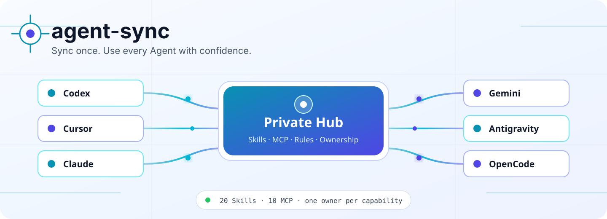
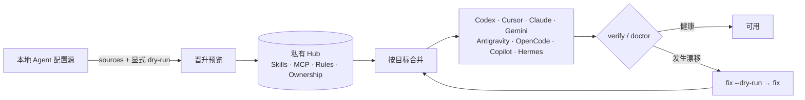

<p align="right">
  <a href="README.md">English</a> · 简体中文
</p>

<picture>
  <source media="(prefers-color-scheme: dark)" srcset="assets/readme/agent-sync-hero-dark.svg">
  <source media="(prefers-color-scheme: light)" srcset="assets/readme/agent-sync-hero-light.svg">
  
</picture>

<p align="center">
  <strong>用一个私有 Hub，统一管理多个 AI Agent 的 Skills、MCP 服务器、规则与能力归属。</strong>
</p>

<p align="center">
  <a href="LICENSE"></a>
  
  
  
</p>

<p align="center">
  <a href="#为什么选择-agent-sync">为什么</a> ·
  <a href="#60-秒快速开始">快速开始</a> ·
  <a href="#支持的工具">支持工具</a> ·
  <a href="#安全设计">安全设计</a> ·
  <a href="#命令参考">命令参考</a>
</p>

## 为什么选择 agent-sync

当你同时使用多个 AI 编程 Agent 时，首先出现的往往不是智能不足，而是配置混乱：

- 每个产品都把 Skills、MCP 服务器和指令存放在不同位置；
- 产品原生插件和共享 Hub 可能重复暴露同一种能力；
- 共享定义、机器本地路径与凭据应由不同主体管理。

`agent-sync` 把这些分散配置组织成一个可审计的系统。公开仓库只保存同步器；
你期望的共享状态保存在独立的私有 Hub 中，而产品专属插件和本地凭据继续归原产品管理。

## 与普通同步脚本有什么不同

| 能力 | agent-sync 的处理方式 |
|---|---|
| Skills | 将 Hub 明确允许的 Skills 以符号链接分发给受支持的 Agent |
| MCP | 合并共享服务器，同时保留工具专属服务器和本地秘密 |
| 规则 | 注入受管理区块，不覆盖无关指令 |
| 能力归属 | 为每个目标上的每项能力选定唯一有效提供方 |
| 配置晋升 | 对已有配置排序、预览来源，仅在显式命令后晋升 |
| 健康检查 | 通过 `status`、`verify`、`doctor` 和 `fix --dry-run` 解释漂移 |

它是配置控制平面，不是第二套插件管理器。Cursor、Codex、Claude、Gemini、
VS Code 等产品的原生扩展仍由原产品负责。

## 60 秒快速开始

```bash
git clone https://github.com/LittlePeter52012/agent-sync.git ~/.local/share/agent-sync
ln -sf ~/.local/share/agent-sync/bin/agent-sync ~/.local/bin/agent-sync

agent-sync init
agent-sync sources
agent-sync sync --from cursor --dry-run
agent-sync sync
agent-sync doctor --runtime
```

`sources` 只读。`sync --from` 会先预览 MCP 变更，再决定是否晋升配置；它不会
仅根据修改时间自动选择来源。`sync` 随后分发 Hub 当前状态，不会顺便发现或更新依赖版本。

## 支持的工具

| 使用端 | Skills | 共享 MCP | 受管理规则 | 范围说明 |
|---|:---:|:---:|:---:|---|
| Codex / ChatGPT | ✓ | ✓ | ✓ | 保留产品插件与工具专属 MCP |
| Claude Code | ✓ | ✓ | ✓ | 使用官方用户级 MCP CLI |
| Cursor | ✓ | ✓ | — | 已审查能力可由产品插件提供 |
| Gemini CLI | ✓ | ✓ | ✓ | 使用官方 `~/.agents/skills` 别名 |
| Gemini global | ✓ | ✓ | ✓ | 独立的全局配置面 |
| Antigravity App | ✓ | ✓ | 共享 | 独立的 App 配置面 |
| Antigravity CLI（`agy`） | ✓ | ✓ | 共享 | Antigravity 自动化的首选接口 |
| Antigravity IDE | ✓ | ✓ | 共享 | 独立的 IDE 配置与扩展状态 |
| OpenCode | ✓ | ✓ | — | OpenCode 专属编排继续由产品管理 |
| VS Code / Copilot | ✓ | ✓ | ✓ | 包括现有 VS Code Profiles |
| Hermes | ✓ | — | — | 通过原生 `skills.external_dirs` 使用共享 Skills |
| Multica | 允许列表 | — | 允许列表 | 仅作为可选、显式启用的控制平面适配器 |

“共享”表示 Gemini / Antigravity 系列使用同一个受管理的全局规则面，而不是收到重复规则文件。

## 工作原理



Hub 是共享配置的期望状态。每个目标适配器负责转换格式、保留目标自有值，并验证最终结果。

## 安全设计

- **公开工具，私有状态。** 本仓库只包含通用代码与示例；个人 Skills、MCP 定义、
  规则和退役名称应保存在私有 Hub。
- **凭据留在本机。** Hub 定义使用 `${ENV_VAR}` 占位符；同步时可以保留目标端
  已有凭据，而不把值打印出来。
- **一项能力只有一个提供方。** 已审查的产品插件可在对应目标上抑制同能力的
  Hub 配置，避免出现重复工具。
- **一次变更只用一个接口。** 不要同时通过 CLI 和 MCP 修改同一个对象。
- **本地执行不等于离线。** 本地启动的 CLI 或 MCP 仍可能向所配置的云端 API
  发送数据；工具会分别描述执行位置与数据去向。
- **不确定时停止。** 能力归属不明确、策略格式错误、公开/私有边界不安全，
  或环境变量占位符无法解析时，操作会失败关闭。

## 常用工作流

```bash
agent-sync status                              # 简洁的覆盖状态
agent-sync ownership                          # 解释能力提供方
agent-sync verify                             # 结构验证
agent-sync verify --strict --scope managed    # Hub 管理范围的运行时门禁
agent-sync fix --dry-run                       # 预览确定性修复
agent-sync audit                              # 检查令牌、个人信息和仓库可见性
```

显式采用某个已有 MCP 配置：

```bash
agent-sync sources
agent-sync sync --from cursor --dry-run
agent-sync sync --from cursor
```

## 命令参考

| 命令 | 用途 |
|---|---|
| `agent-sync init` | 根据通用示例创建最小私有 Hub |
| `agent-sync sources [--json]` | 对本地 MCP 来源进行只读排序 |
| `agent-sync sync [--from TOOL] [--dry-run\|--yes]` | 分发 Hub 状态，或先显式晋升一个 MCP 来源 |
| `agent-sync skills [--force]` | 将允许列表中的 Skills 链接到受支持工具 |
| `agent-sync mcp` | 合并共享 MCP，同时保留目标自有服务器与秘密 |
| `agent-sync rules` | 协调受管理的指令区块 |
| `agent-sync ownership [CAPABILITY] [--target TARGET] [--json]` | 解释实际能力提供方 |
| `agent-sync trace mcp NAME` | 显示不含秘密的 MCP 归属与位置 |
| `agent-sync list` / `status` | 显示覆盖范围与当前状态 |
| `agent-sync verify [--strict] [--scope all\|managed]` | 验证结构和可选的运行时健康状态 |
| `agent-sync doctor [--runtime] [--strict] [--scope all\|managed]` | 诊断配置、能力归属与运行时健康 |
| `agent-sync fix [--dry-run]` | 预览或执行有界、确定性的修复 |
| `agent-sync all [--force]` | 完整同步 Skills + MCP + Rules，并执行受管理运行时门禁 |
| `agent-sync test` | 运行 Python、语法、隐私和 Bash 评估测试 |
| `agent-sync update [--check] [--hub] [--sync]` | 更新工具，并可选更新 Hub 和目标端 |
| `agent-sync pull` / `push [-m MSG]` | 拉取私有 Hub，或经隐私检查后推送私有 Hub |

<details>
<summary><strong>Gemini 与 Antigravity 配置面</strong></summary>

Gemini CLI、Gemini global、Antigravity App、Antigravity CLI 和 Antigravity IDE
是不同的配置消费者。独立 Antigravity CLI 是 `agy`；名为 `antigravity` 的可执行文件
可能只会启动桌面应用。Skills 保持为 Hub 支持的链接，MCP 合并会保留本地服务器和凭据，
共享规则则使用单一全局 `GEMINI.md` 配置面。

</details>

<details>
<summary><strong>插件与能力归属</strong></summary>

目标选择可以是 `auto`、`hub`、`plugin:&lt;id&gt;`、`target:&lt;provider&gt;`
或 `disabled`。`auto` 只接受身份已审查且当前启用证据有效的提供方。显式归属缺失、
多个已审查提供方冲突、策略格式错误或产品状态不确定时，系统会报告问题，而不是静默复制能力。
agent-sync 不负责安装、移除或认证产品插件。

</details>

<details>
<summary><strong>Multica 与远程部署</strong></summary>

`agent-sync multica` 默认只读；`--apply` 仅按照私有 Hub 修改允许列表中的 Multica
Skills、任务分配与 Squad 字段。普通的 `sync`、`all` 和 `fix` 不会调用它。

`agent-sync deploy HOST` 先执行只读 SSH 预检。显式 `--apply` 会流式传输已提交的
工具和 Hub 归档、保留远端备份并执行同步，但不会复制产品凭据。

</details>

<details>
<summary><strong>经 Agent 审查的 MCP 依赖维护</strong></summary>

```bash
agent-sync deps check --json
# 审查官方发布说明与兼容性。
agent-sync deps pin SERVER VERSION --dry-run
agent-sync deps pin SERVER VERSION --apply
agent-sync deps smoke SERVER --target cursor
agent-sync test
agent-sync sync
```

`all` 只读取缓存的依赖建议，不会自行发现、批准或固定升级版本。

</details>

## 私有 Hub 目录

```text
~/.config/agent-hub/
  manifest.yaml              # 明确的 Skill 允许列表
  skills/<name>/SKILL.md
  mcp/shared-servers.json    # 使用 ${ENV} 占位符的共享定义
  mcp/retired-servers.json
  policies/tool-scopes.json
  multica/desired-state.json
  rules/*.md
```

环境变量：

- `AGENT_HUB_ROOT` — 私有 Hub 路径，默认为 `~/.config/agent-hub`
- `AGENT_SYNC_HOME` — 工具安装路径，通常自动检测

## 参与贡献

请让公开变更保持通用且可复现。发布前运行 `agent-sync test` 和 `agent-sync audit`。
不要提交个人 Hub 内容、凭据、机器专属绝对路径或产品认证状态。

## 许可证

[MIT](LICENSE)
